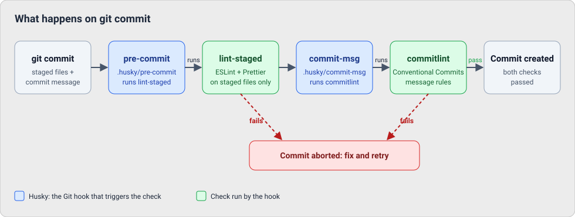

# Working in this repository

## Package managing

### Adding dependencies

This repository uses pnpm's shared catalog for dependency versions. Adding a dependency
records its version in the catalog in `pnpm-workspace.yaml`, and the package manifest
refers to that catalog entry:

```sh
pnpm add {package_name}
```

For a development-only dependency, include `-D`:

```sh
pnpm add {package_name} -D
```

> **Note:** this repository uses `catalogMode: strict`, so pnpm always saves new
> dependencies to the catalog. The `--save-catalog` flag is not required.

Run the command from the package that should use the dependency. For a specific
workspace package, you can target it from the repository root with `--filter`:

```sh
pnpm --filter {workspace_package} add {package_name}
```

Avoid adding a version directly to a package manifest; shared dependency versions
belong in the workspace catalog.

> **Important:** These commands are meant for workspace packages (`packages/*` and
> `apps/*`), not the repository root. Run them from inside the package directory, or from
> the root with `--filter`. Running a plain `pnpm add` at the root is refused by pnpm.
>
> #### What belongs in the root
>
> The root `package.json` is private and is not a deployable package. It holds only
> the tooling shared by the whole repository: linting, formatting, type checking,
> testing, commit hooks and the TypeScript toolchain (for example `eslint`,
> `prettier`, `typescript`, `vitest`, `husky`, `commitlint`, `lint-staged` and `tsx`).
> Anything a package needs at build time or runtime belongs in that package, not in
> the root.
>
> To add a root tool, use `-Dw`, the shorthand for `-D` (`--save-dev`) plus `-w`
> (`--workspace-root`):
>
> ```sh
> pnpm add {package_name} -Dw
> ```
>
> To remove one:
>
> ```sh
> pnpm remove {package_name} -w
> ```
>
> Root dependencies are also recorded in the catalog, so the same rule about
> cleaning up unused catalog entries applies.

### Removing dependencies

As with adding, run these from inside the package (or use `--filter`), not the
repository root. To remove a root tool, see [What belongs in the root](#what-belongs-in-the-root).

Remove a dependency from the package that uses it with:

```sh
pnpm remove {package_name}
```

Use `--filter {workspace_package}` to target a workspace package from the root:

```sh
pnpm --filter {workspace_package} remove {package_name}
```

This removes the dependency from that package's manifest, but does not delete its
shared catalog entry. If no other package uses the dependency, remove its entry
from the `catalog` section of `pnpm-workspace.yaml`.

## Git hooks and commit checks

Three root tools work together to check code and commit messages before a commit is created.

- **[Husky](https://typicode.github.io/husky/)** manages Git hooks. It runs the scripts in
  `.husky/` at specific points in the Git workflow, and is installed for every contributor by
  the `prepare` script when running `pnpm install`.
- **[lint-staged](https://github.com/lint-staged/lint-staged)** runs commands only on the files
  staged for the commit, so checks stay fast. Its file patterns and commands are configured
  in the `lint-staged` section of `package.json` (ESLint and Prettier for code, Prettier for
  JSON, Markdown and YAML).
- **[commitlint](https://commitlint.js.org/)** checks that the commit message follows the
  Conventional Commits format, using the rules in `commitlint.config.js`.

### How they relate

Husky is the trigger; the other two are the checks it runs. If either check fails, the
commit is aborted.


